# State machines

Every workflow in the app that has "a state and rules about what may happen next" is declared **once, as data**, in
`packages/curriculum/src/machines.ts` (kit: `packages/engine/src/machine.ts`). Everything below the marker is *generated*
from those declarations — do not edit it by hand (`UPDATE_DOCS=1 npx vitest run test/machines.test.ts` in `packages/curriculum`; a test fails if it is stale).

## Why (what this bought us)

| For | What changed |
|---|---|
| **Users** | Unavailable actions say *why* (before and after clicking). A question can only be answered once. The ledger story can be replayed. Leaving a page stops its animation. Failed loads offer *Try again* instead of a forever-spinner. If progress cannot be saved, a banner says so on every page. Impossible stories (forfeiting shares nobody failed to pay for) are explained instead of producing nonsense. |
| **Developers** | Rules live in one place and are drawn automatically (diagrams below). `validateSpec` rejects dead ends, unreachable states and missing docs. Random-walk tests prove no machine can leave its declared states. UI code asks `machine.can(event)` / `machine.why(event)` instead of re-deriving rules from booleans. |
| **Agents / automation** | Every machine is readable from the page: `data-machine` + `data-state` on its element, `<html data-app data-net>`, `<main data-route>`, `<article data-tab>`, and `window.__AU__.machines()` (ids, states and last transitions — state names only, no student data). Wait for a state instead of sleeping: `page.waitForSelector('[data-machine="ledger-player"][data-state="FINISHED"]')`. Refusals are returned as reasons, never exceptions. |

## Inventory — what was found by reading the code

**Made explicit (13)** — each was a cluster of booleans, timers, `hidden` flags or label swaps:

| Machine | Was hiding in | Defect the implicit version had |
|---|---|---|
| `ledger-player` | `timer`, `step`, button text | timer kept running after leaving the page; Play was a dead button after the story ended |
| `practice-question` | `done` flag, `nextBtn.hidden`, `disabled` on hint buttons | hints stayed clickable after answering; "already checked" was only a hidden guard |
| `trainer-round` | `answered` flag, `i`/`score` | — (rules now shared and tested) |
| `card-check` | `answered` set | — |
| `async-resource` | `loading()` placeholder + `void (async () => …)()` | a rejected load left a spinner forever; late results could write into a page the student had left |
| `storage` | `storageMode` variable, `dbp` promise | silent data loss: no warning outside the Home footer when IndexedDB was unavailable or a write failed |
| `app-boot`, `network` | `navigator.onLine` reads, ad-hoc render | nothing for automation to wait on |
| `cas-voucher` | role checks scattered across `enter/verify/reject` | messages duplicated in three places |
| `cas-year` | `closed` boolean, `year` counter | a Viewer could start the next year; three separate guards with different orders |
| `ai-ask` | none (no state) | double-asking possible; no distinct "withheld" outcome |
| `lab-run` | `.result` content only | nothing readable by tests |
| `share-lifecycle` (domain) | hand-written stage array in the lab | blank input was treated as "forfeited"; forfeiture without unpaid calls produced meaningless entries |
| `journal-entry` (engine) | `reversed` Map + two `if`s in `Ledger.reverse` | rule existed only as code paths; now a spec with the same error texts and a public `entryStatus()` |

**Made explicit, but not as a `Machine`:**
* **Navigation** — two parallel `if` chains (page and header highlight) must agree. Now one pure route table (`apps/web/src/routes.ts`); a test proves it equals the old behaviour on 29 paths.
* **Tutor proxy limiter** — `Map` + `day` + `today` variables. Now `apps/tutor-proxy/limits.mjs` (per-client OPEN↔THROTTLED, global OPEN↔CAPPED), tested with a fake clock: the UTC-midnight reset was untested before, and idle clients were never evicted (unbounded memory).

**Deliberately left alone, and why:**
* **Mastery level (0–5)** — *derived from the whole event history*, not stepped through events; order of reading and practising does not matter. A machine would change the meaning, so it stays a pure function (`levelFor`), tested.
* **Lab tabs, practice mode, class/route selectors** — free choice among options with no guards: settings, not workflows (tabs expose `data-tab`).
* **Project checklist, teacher file list** — sets that grow; no ordering rules.
* **Service worker (install → activate → fetch)** — lifecycle owned by the browser.
* **Engine calculators** (admission, retirement, dissolution…) — pure functions of inputs, no state over time.
* **Legacy `index.html`** (352 KB; its Simulator keeps `SIM` state and a rebuild flag, 36 timers) — shipped separately under the strangler plan; not touched. Its own implicit machines are a separate piece of work.

## How to add or change a machine

1. Edit the spec in `packages/curriculum/src/machines.ts` (states have a `doc`; guards are pure; give every refusal a `reason`/`blocked` text a student could read).
2. `cd packages/curriculum && UPDATE_DOCS=1 npx vitest run test/machines.test.ts && npx vitest run` — validity, random-walk and scenario tests run; this file regenerates.
3. In the UI: create `new Machine(SPEC, ctx)`, call `track(element, machine)` (and `onDispose(() => unregister(machine))`), and ask `can/why/send`. Show `why()` to the user; never hide an unavailable action silently.
4. Add a browser check to `e2e/web-app-states.cjs` that waits on the new `data-state`.

⚑ in a diagram = the transition has a guard.

<!-- BEGIN GENERATED -->

### `ledger-player` — UI

Play / pause / step / reset / speed for the Ravi story on the Journal → Ledger page. DISPOSE stops the timer when the student leaves the page.

Implemented in: `apps/web/src/pages/ledger.ts`

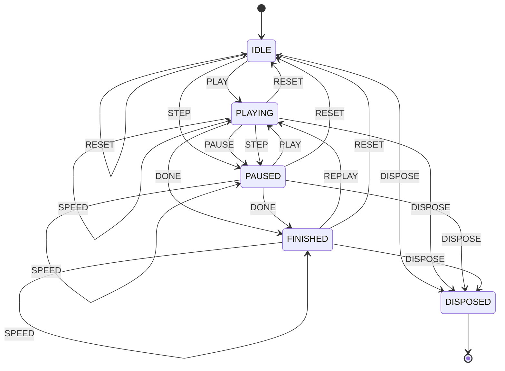

| State | Meaning | Events |
|---|---|---|
| `IDLE` | Nothing posted from the story yet. | `PLAY`→`PLAYING`, `STEP`→`PAUSED`, `SPEED`→`IDLE`, `RESET`→`IDLE`, `DISPOSE`→`DISPOSED` |
| `PLAYING` | A timer posts one transaction per tick. | `PAUSE`→`PAUSED`, `STEP`→`PAUSED`, `TICK`→`PLAYING`, `SPEED`→`PLAYING`, `DONE`→`FINISHED`, `RESET`→`IDLE`, `DISPOSE`→`DISPOSED` |
| `PAUSED` | Stopped part-way; Step moves one transaction at a time. | `PLAY`→`PLAYING`, `STEP`→`PAUSED`, `SPEED`→`PAUSED`, `DONE`→`FINISHED`, `RESET`→`IDLE`, `DISPOSE`→`DISPOSED` |
| `FINISHED` | All transactions of the story are posted. | `REPLAY`→`PLAYING`, `SPEED`→`FINISHED`, `RESET`→`IDLE`, `DISPOSE`→`DISPOSED` |
| `DISPOSED` (final) | The student left the page; the timer is cleared. | — |

### `practice-question` — UI

One generated question. Beginner mode lets a wrong answer be retried; every other mode ends at the first check. After SUBMITTED nothing but NEXT is possible, so an answer can never be recorded twice.

Implemented in: `apps/web/src/pages/practice.ts`

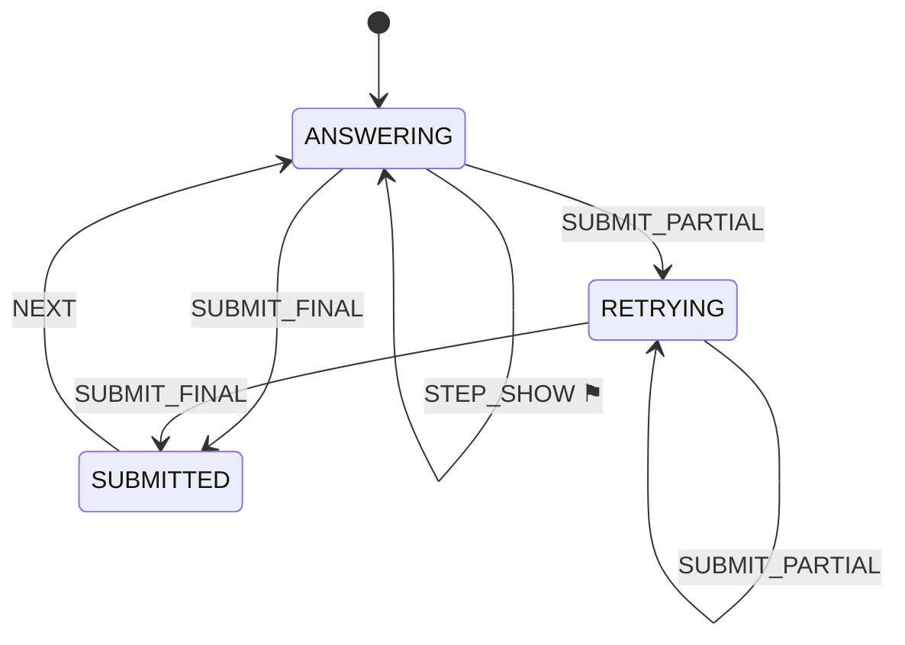

| State | Meaning | Events |
|---|---|---|
| `ANSWERING` | Waiting for the first answer. Hints (and, in Beginner mode, steps) can be revealed. | `HINT`→`ANSWERING` ⚑, `STEP_SHOW`→`ANSWERING` ⚑, `SUBMIT_PARTIAL`→`RETRYING`, `SUBMIT_FINAL`→`SUBMITTED` |
| `RETRYING` | Beginner mode only: the last answer was wrong, try again. | `HINT`→`RETRYING` ⚑, `STEP_SHOW`→`RETRYING` ⚑, `SUBMIT_PARTIAL`→`RETRYING`, `SUBMIT_FINAL`→`SUBMITTED` |
| `SUBMITTED` | Final answer recorded; the full working is shown. | `NEXT`→`ANSWERING` |

### `trainer-round` — UI

A round of the Debit & Credit Trainer.

Implemented in: `apps/web/src/pages/trainer.ts`

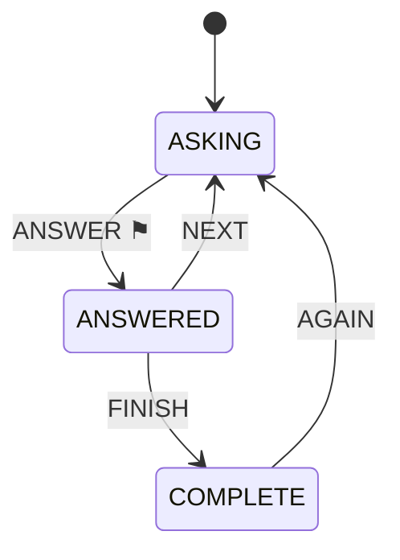

| State | Meaning | Events |
|---|---|---|
| `ASKING` | A transaction is shown; waiting for a debit and a credit account. | `ANSWER`→`ANSWERED` ⚑ |
| `ANSWERED` | Checked; the rule behind each side is shown. | `NEXT`→`ASKING`, `FINISH`→`COMPLETE` |
| `COMPLETE` | All questions done; the score is shown. | `AGAIN`→`ASKING` |

### `card-check` — UI

A single self-check question on a concept card.

Implemented in: `apps/web/src/pages/cards.ts`

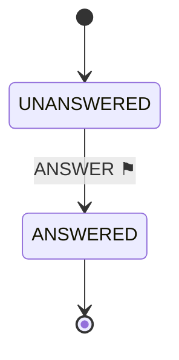

| State | Meaning | Events |
|---|---|---|
| `UNANSWERED` | Waiting for a choice. | `ANSWER`→`ANSWERED` ⚑ |
| `ANSWERED` (final) | Locked, explanation shown. | — |

### `async-resource` — UI

Used by every page that reads stored data. FAILED always offers Retry (a spinner can never hang forever); DISPOSED ignores results that arrive after the student left.

Implemented in: `apps/web/src/async.ts (progress, rescue, assignment pages)`

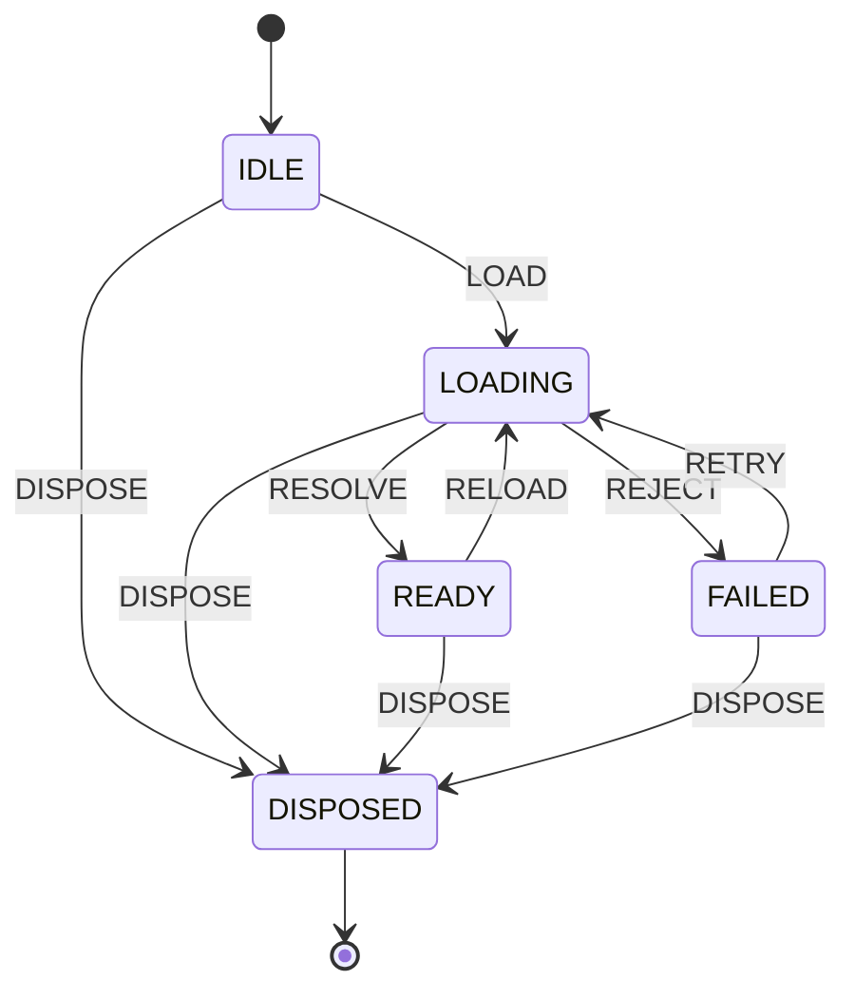

| State | Meaning | Events |
|---|---|---|
| `IDLE` | Not started. | `LOAD`→`LOADING`, `DISPOSE`→`DISPOSED` |
| `LOADING` | Spinner shown. | `RESOLVE`→`READY`, `REJECT`→`FAILED`, `DISPOSE`→`DISPOSED` |
| `READY` | Content shown. | `RELOAD`→`LOADING`, `DISPOSE`→`DISPOSED` |
| `FAILED` | Error message with a Retry button. | `RETRY`→`LOADING`, `DISPOSE`→`DISPOSED` |
| `DISPOSED` (final) | Page left; late results are dropped. | — |

### `storage` — UI

Progress is saved in IndexedDB on the device. If that is unavailable the app keeps working from memory and tells the student plainly that progress will be lost when the tab closes.

Implemented in: `apps/web/src/store.ts`

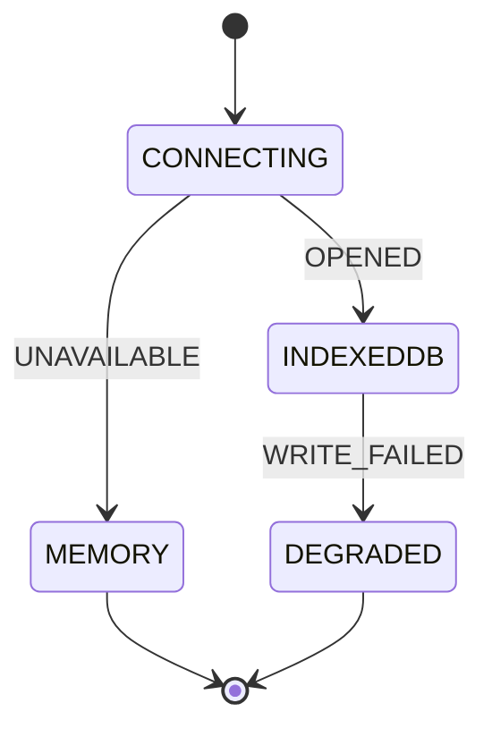

| State | Meaning | Events |
|---|---|---|
| `CONNECTING` | Opening IndexedDB. | `OPENED`→`INDEXEDDB`, `UNAVAILABLE`→`MEMORY` |
| `INDEXEDDB` | Normal: saved on this device. | `WRITE_FAILED`→`DEGRADED` |
| `MEMORY` (final) | IndexedDB unavailable (private mode / blocked): progress lasts until the tab closes. A banner says so. | — |
| `DEGRADED` (final) | IndexedDB opened but a write failed; some progress is only in memory. A banner says so. | — |

### `app-boot` — UI

Start-up of the web app. Automation should wait for READY (`<html data-app="ready">`) instead of sleeping.

Implemented in: `apps/web/src/main.ts`

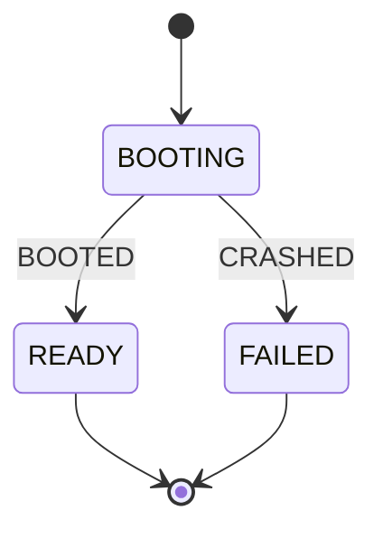

| State | Meaning | Events |
|---|---|---|
| `BOOTING` | Opening storage, loading the saved profile. | `BOOTED`→`READY`, `CRASHED`→`FAILED` |
| `READY` (final) | First page rendered. | — |
| `FAILED` (final) | Start-up crashed; a message is shown. | — |

### `network` — UI

Browser connectivity. Everything in the app works offline; the header only tells the student.

Implemented in: `apps/web/src/main.ts`

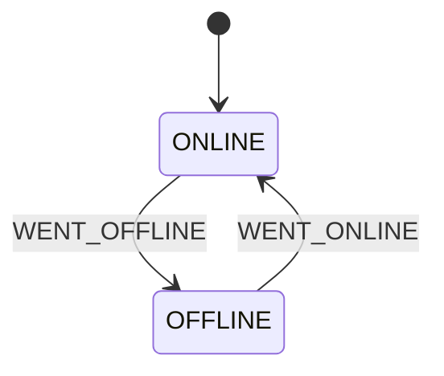

| State | Meaning | Events |
|---|---|---|
| `ONLINE` | Connected. | `WENT_OFFLINE`→`OFFLINE` |
| `OFFLINE` | No network; cached app keeps working. | `WENT_ONLINE`→`ONLINE` |

### `cas-voucher` — UI

Maker–checker: an Accountant enters a voucher, a different role (Checker) verifies and posts it. Posted vouchers are never edited or deleted.

Implemented in: `apps/web/src/pages/cas.ts`

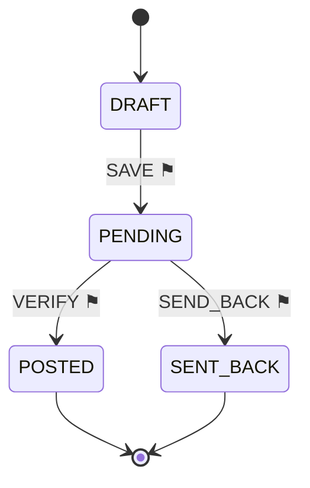

| State | Meaning | Events |
|---|---|---|
| `DRAFT` | Being typed in the form. | `SAVE`→`PENDING` ⚑ |
| `PENDING` | Waiting in the verification queue; not in the books yet. | `VERIFY`→`POSTED` ⚑, `SEND_BACK`→`SENT_BACK` ⚑ |
| `POSTED` (final) | In the ledger (journal, ledger, trial balance, audit trail). | — |
| `SENT_BACK` (final) | Rejected by the checker; removed from the queue. | — |

### `cas-year` — UI

The accounting year: open for vouchers, then closed by a Checker (closing entries), then the next year opens with an opening entry. RESTORE_* is used when loading a saved or backed-up book.

Implemented in: `apps/web/src/pages/cas.ts`

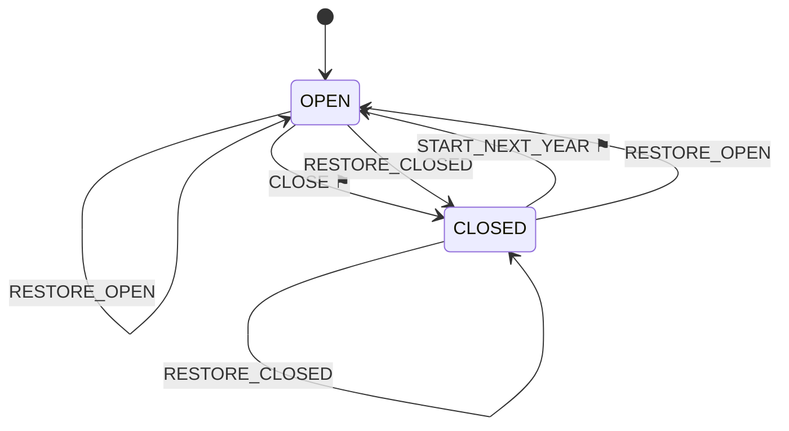

| State | Meaning | Events |
|---|---|---|
| `OPEN` | Vouchers can be entered and posted. | `CLOSE`→`CLOSED` ⚑, `RESTORE_OPEN`→`OPEN`, `RESTORE_CLOSED`→`CLOSED` |
| `CLOSED` | Closing entries posted; no more vouchers this year. | `START_NEXT_YEAR`→`OPEN` ⚑, `RESTORE_OPEN`→`OPEN`, `RESTORE_CLOSED`→`CLOSED` |

### `ai-ask` — UI

One question to the optional AI tutor. WITHHELD = the server refused to show a reply that contained a figure the engine did not supply. The core app never depends on this.

Implemented in: `apps/web/src/pages/tutor.ts`

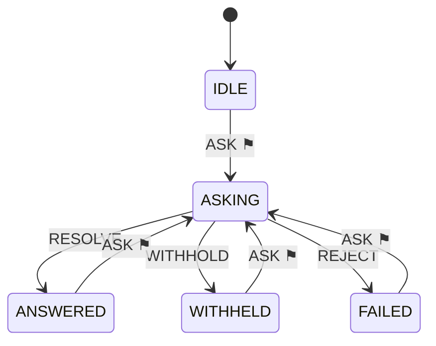

| State | Meaning | Events |
|---|---|---|
| `IDLE` | No question asked yet. | `ASK`→`ASKING` ⚑ |
| `ASKING` | Waiting for the server (20 s timeout). | `RESOLVE`→`ANSWERED`, `WITHHOLD`→`WITHHELD`, `REJECT`→`FAILED` |
| `ANSWERED` | Reply shown. | `ASK`→`ASKING` ⚑ |
| `WITHHELD` | Reply withheld by the output guard; the student is told why. | `ASK`→`ASKING` ⚑ |
| `FAILED` | Server unreachable or refused; the offline helper is still there. | `ASK`→`ASKING` ⚑ |

### `lab-run` — UI

The result area of a lab: nothing yet, a result, or an input/engine error explained in words.

Implemented in: `apps/web/src/pages/lab.ts`

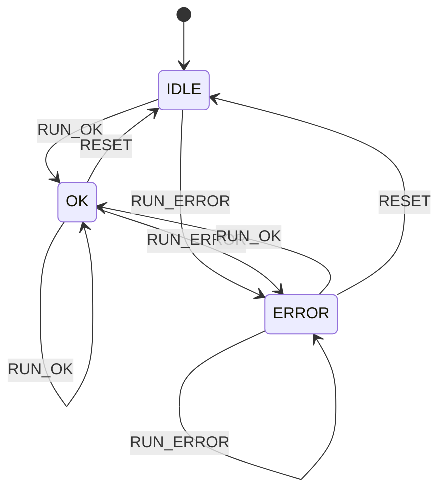

| State | Meaning | Events |
|---|---|---|
| `IDLE` | Not run yet. | `RUN_OK`→`OK`, `RUN_ERROR`→`ERROR` |
| `OK` | Result shown. | `RUN_OK`→`OK`, `RUN_ERROR`→`ERROR`, `RESET`→`IDLE` |
| `ERROR` | A message explains what to fix; the field is marked. | `RUN_OK`→`OK`, `RUN_ERROR`→`ERROR`, `RESET`→`IDLE` |

### `share-lifecycle` — domain

What can happen to an issue of shares: application → allotment → calls → paid, or unpaid → forfeited → re-issued. Syllabus limit: no interest on calls in arrears or advance.

Implemented in: `packages/curriculum/src/machines.ts → apps/web/src/labs/company.ts`

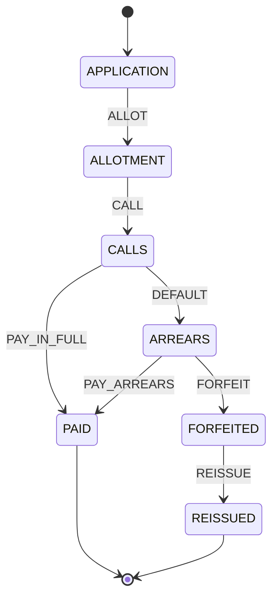

| State | Meaning | Events |
|---|---|---|
| `APPLICATION` | Application money received. | `ALLOT`→`ALLOTMENT` |
| `ALLOTMENT` | Shares allotted (pro-rata if over-subscribed); excess money adjusted or refunded. | `CALL`→`CALLS` |
| `CALLS` | Call money demanded on the allotted shares. | `PAY_IN_FULL`→`PAID`, `DEFAULT`→`ARREARS` |
| `PAID` (final) | Every instalment received. | — |
| `ARREARS` | Some shareholders did not pay a call (calls in arrears). | `PAY_ARREARS`→`PAID`, `FORFEIT`→`FORFEITED` |
| `FORFEITED` | Shares cancelled; amount received is kept in Share Forfeited A/c. | `REISSUE`→`REISSUED` |
| `REISSUED` (final) | Forfeited shares issued again; any gain goes to Capital Reserve. | — |

<!-- END GENERATED -->
